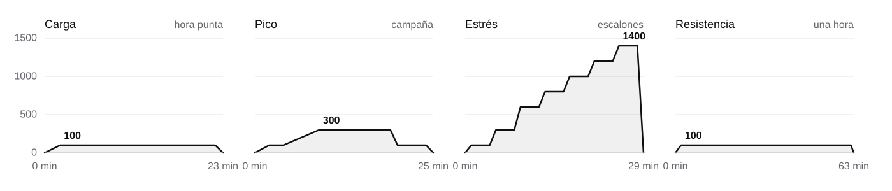
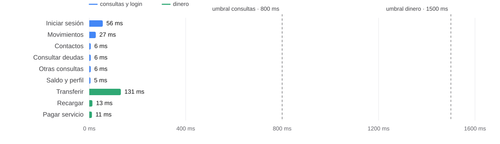
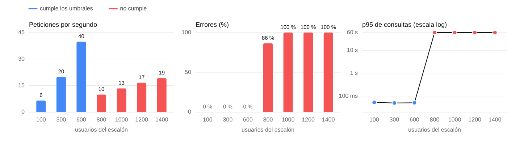
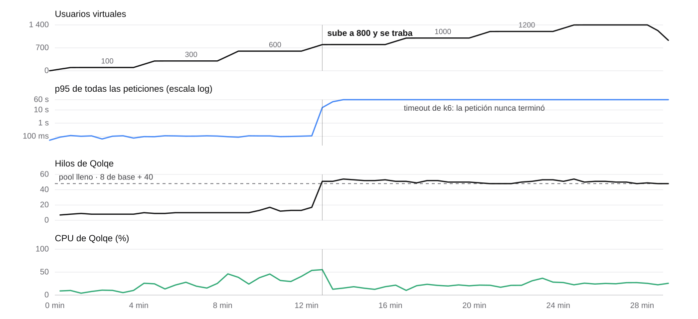
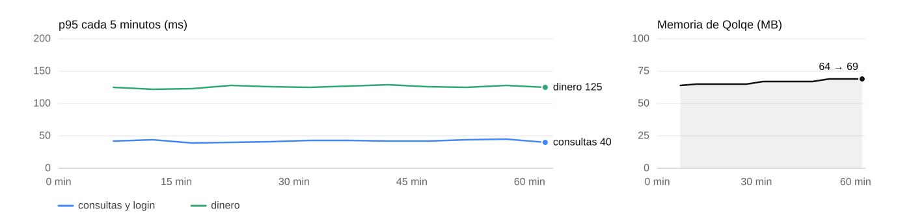

# Rendimiento · Quincena Qolqe

El requerimiento de la Parte 3 pregunta tres cosas: si Qolqe cumple en la hora punta (3000 sesiones por hora), si aguanta la campaña del 15 y fin de mes (el triple de usuarios en 15 minutos) y hasta cuántos usuarios simultáneos puede crecer. Y pone una condición que no es de tiempo: ninguna operación de dinero puede quedar a medias ni aplicarse dos veces.

**Respuesta corta:** la hora punta y la campaña cumplen con mucho margen. El límite está entre 600 y 800 usuarios y, al pasarlo, Qolqe no se pone lento: se traba (DEF-10). El riesgo más serio no es de carga: dos transferencias simultáneas de la misma cuenta se saltan el límite diario y el saldo (DEF-11).

El informe completo, con el modelo de carga, los supuestos y todas las tablas, está en [`Informe_Rendimiento_G5.docx`](Informe_Rendimiento_G5.docx) ([PDF](Informe_Rendimiento_G5.pdf)). Los scripts y cómo correrlos, en [`tests/performance/`](../tests/performance/README.md).

## Cómo se probó

- **Herramienta:** k6 v2.3. Los umbrales del requerimiento van en el script (`p(95)<800` para consultas, `p(95)<1500` para dinero, `rate<0.01` para fallas) y k6 dice si pasó.
- **Entorno:** Qolqe en Docker con 1 CPU y 1 GB (uvicorn con un proceso, SQLite en WAL); k6 nativo en la misma laptop (MacBook Pro M5, 16 GB). Es una línea base relativa, no la capacidad de producción.
- **Sesión:** cada VU inicia sesión y hace 6 operaciones sorteadas con los porcentajes del requerimiento, con una pausa de 10 a 25 s (triangular, promedio exacto de 18 s).
- **Usuarios:** hora punta = 3000 sesiones/h × 2 min = **100 VUs** (ley de Little); campaña = **300 VUs**, con la subida en los primeros 5 minutos.
- **Datos:** un usuario distinto por VU, con saldo, deudas y contactos propios, para que ninguna regla de negocio falle por compartir datos.
- **Dinero:** antes y después de cada prueba se compara la base: saldos contra movimientos, cada transferencia con su salida y su entrada, ninguna deuda pagada dos veces y las operaciones guardadas contra las respuestas 201 que vio k6.
- **Recursos:** CPU, memoria e hilos de Qolqe y de k6, cada segundo.

## Modelo de carga: de qué sale cada valor

**Qué hace un usuario virtual (VU).** Un VU es un cliente de Qolqe con sesión abierta. Cada iteración es una sesión completa: inicia sesión y hace 6 operaciones, esperando antes de cada una (`tests/performance/sesion.js`). Cada operación se sortea con los porcentajes del requerimiento (saldo y perfil 30 %, movimientos 15 %, transferir 15 %, contactos 10 %, recargar 10 %, deudas 6 %, pagar 4 %, otras 10 %). Cada VU usa siempre a su propio usuario, con saldo, deudas y contactos propios (`tests/performance/datos/preparar_datos.py`), así ninguna regla de negocio se dispara por compartir datos.

| Parámetro | Valor | De dónde sale | Cálculo |
|---|---|---|---|
| Usuarios a la vez en hora punta | **100 VUs** | «Unas 3000 sesiones por hora, de 2 minutos cada una» | Ley de Little: usuarios a la vez = llegadas × duración = (3000 / 3600 s) × 120 s = 100 |
| Usuarios a la vez en la campaña | **300 VUs** | «El triple de usuarios simultáneos que en hora punta» | 3 × 100 |
| Operaciones por sesión | **6** y un login | «Cada sesión: iniciar sesión y 6 operaciones» | Da 7.24 peticiones por sesión contando la consulta previa a cada pago |
| Think time | **10 a 25 s, promedio 18 s** | «Entre operaciones, una pausa de 10 a 25 s (18 s en promedio)» | Distribución triangular 10-19-25: (10 + 19 + 25) / 3 = 18 |
| Ramp-up de la hora punta | **120 s** (0 → 100) | Una sesión dura 120 s | Ver abajo |
| Ramp-up de la campaña | **300 s** (100 → 300) | «La mayoría inicia sesión en los primeros 5 minutos» | Dato del requerimiento |
| Ramp-up del estrés | **60 s** por escalón, 180 s sostenidos | Medir cada escalón en régimen | Ver abajo |
| Duración de la hora punta | **20 min** estables | «Unas 3000 sesiones por hora» no dice cuánto probar | 20 min dan unas 1000 sesiones y 7000 peticiones: suficientes para un p95 estable por tipo. La hora completa va en resistencia |

**Por qué ese think time.** (1) Es un dato del requerimiento: el rango y el promedio vienen dados; no lo elegimos. (2) Es lo que convierte 100 VUs en la hora punta real. Cada VU hace 7.24 peticiones en una sesión que dura poco menos de 2 min (6 pausas × 18 s = 108 s, más los tiempos de respuesta), es decir, unas 0.065 peticiones por segundo; con 100 VUs son unas 6.5 peticiones por segundo y medimos 6.7. Con una pausa de 5 s serían unas 22 por segundo, 3.4 veces la hora punta real, y la prueba ya no respondería la pregunta del negocio. (3) Se sortea en un rango en lugar de usar 18 s fijos para que los usuarios no queden sincronizados (todos pidiendo en el mismo segundo, como un reloj), cosa que no pasa con personas reales. La distribución triangular respeta el rango y el promedio exactos. (4) No sumamos los 12 s que faltan para los 2 min de la sesión: así cada VU hace un 10 % más de sesiones de las necesarias (unas 3300 por hora). La prueba queda del lado exigente, y por eso el throughput medido (55.4 sesiones por minuto) supera al mínimo de 50.

**Por qué ese ramp-up.** *Hora punta, 120 s:* con la ley de Little, el sistema llega a régimen cuando los primeros usuarios terminan su primera sesión, es decir, a los 120 s. Subir más rápido llenaría la meseta de logins simultáneos que no existen en la hora punta, que es una carga estable. Por eso la subida y la bajada no cuentan en las cifras: se mide solo la meseta. *Campaña, 300 s:* es el dato del requerimiento (la mayoría entra en los primeros 5 minutos). Antes hay 4 min de hora punta para comparar y 4 min después para ver si se recupera. *Estrés, 60 s por escalón y 180 s sostenidos:* la subida de 60 s evita medir el golpe de entrada de los usuarios nuevos, y 180 s son más de una sesión (120 s), así que cada escalón se mide ya en régimen. Los escalones (100, 300, 600, 800, 1000, 1200, 1400) salen de un sondeo previo: una subida continua de 0 a 2000 usuarios que se quebró entre 1000 y 1100, y se midió con más detalle alrededor.

## Resultados

| Prueba | VUs | p95 consultas | p95 dinero | Errores | Throughput | Dinero | Veredicto |
|---|---|---|---|---|---|---|---|
| Carga (hora punta, 20 min) | 100 | 51 ms | 126 ms | 0 % | 55 sesiones/min | cuadra | Cumple |
| Pico (campaña) | 100 → 300 → 100 | 48 ms | 127 ms | 0 % | 166 sesiones/min | cuadra | Cumple, sin degradación |
| Resistencia (60 min) | 100 | 42 ms | 126 ms | 0 % | 56 sesiones/min | cuadra | Cumple |
| Estrés (escalones) | 600 | 51 ms | 126 ms | 0 % | 315 sesiones/min | — | Cumple |
| Estrés (escalones) | 800 | 60 s | 60 s | 86 % | 45 sesiones/min | 6 operaciones sin confirmar | Se traba (DEF-10) |
| Concurrencia (misma cuenta) | 1 | — | — | — | — | límite y saldo superados en 5 de 5 rondas | Falla (DEF-11) |

Umbrales: consultas y login p95 < 800 ms, dinero p95 < 1500 ms, fallas < 1 %, al menos 50 sesiones por minuto con 100 VUs. Para la campaña se tomó como supuesto que «degradación razonable» es hasta el doble de esos tiempos; no hizo falta.

## Resultados frente a los umbrales

Un «cumple» no basta: hay que decir por cuánto, por qué es creíble y qué no dice. Los umbrales salen del requerimiento («el 95 % debe responder en menos de 800 ms», «en menos de 1.5 segundos», «no más del 1 % puede fallar», «sostener el volumen de la hora punta sin acumular retrasos»); para la campaña, «degradación razonable» no trae número y asumimos hasta el doble.

| Prueba | Métrica | Umbral | Resultado | Margen | Veredicto |
|---|---|---|---|---|---|
| Carga · 100 VUs | p95 consultas y login | < 800 ms | 51 ms (login 56 ms) | 15.7 veces mejor | Cumple |
| Carga · 100 VUs | p95 dinero | < 1500 ms | 126 ms | 11.9 veces mejor | Cumple |
| Carga · 100 VUs | Errores | < 1 % | 0.00 % | — | Cumple |
| Carga · 100 VUs | Throughput | ≥ 50 sesiones/min | 55.4 sesiones/min | 11 % más | Cumple |
| Pico · 300 VUs | p95 consultas y login | < 1600 ms (supuesto: el doble) | 48 ms (login 56 ms) | 33 veces mejor | Cumple |
| Pico · 300 VUs | p95 dinero | < 3000 ms (supuesto) | 127 ms | 23.6 veces mejor | Cumple |
| Pico · 300 VUs | Throughput | ≥ 150 sesiones/min (3 × 50) | 165.8 sesiones/min | 10.5 % más | Cumple |
| Resistencia · 60 min | p95 consultas / dinero | < 800 / < 1500 ms | 42 / 126 ms | 19 y 12 veces mejor | Cumple |
| Estrés · 600 VUs | Los tres umbrales de hora punta | — | 51 ms / 126 ms / 0 % | — | Cumple |
| Estrés · 800 VUs | Los tres umbrales de hora punta | — | 60 s / 60 s / 86 % | — | No cumple (DEF-10) |

**Por qué son creíbles.** (1) *Sin cola:* con 100 VUs el CPU de Qolqe promedia 8 %, así que el tiempo de respuesta es casi el tiempo de servicio; por eso los tiempos con 100 y con 300 VUs son iguales (48 contra 51 ms). (2) *Estables:* en las cuatro ventanas de 5 minutos de la meseta el p95 de consultas queda entre 51 y 52 ms y el de dinero entre 123 y 127 ms, así que no se acumulan retrasos. (3) *Sin efecto de la carga:* la mediana con 1 VU es la misma que con 100 (login 52 contra 49 ms, transferir 91 contra 93 ms). (4) *Explicables:* el p95 de dinero de 126 ms es casi todo la pausa de 40 a 120 ms que el antifraude simulado agrega a las transferencias. (5) *El dinero cuadra:* en carga, pico y resistencia se revisaron 13 027 operaciones de dinero, ninguna a medias ni duplicada.

**Qué no dicen.** Que el margen sea de 12 a 33 veces no significa capacidad ilimitada: el límite está entre 600 y 800 usuarios, y ahí el servicio no se degrada, se traba. Es una línea base relativa (una laptop, una instancia de uvicorn, SQLite local), no la capacidad de producción. El «doble» de la campaña es un supuesto nuestro, aunque lo que se midió estaría dentro incluso del umbral de hora punta.

## Hora punta y campaña: cumplen lejos del umbral

Con 100 usuarios, el p95 de consultas fue 51 ms y el de dinero 126 ms (casi todo es la pausa de 40 a 120 ms del antifraude de las transferencias). Las cuatro ventanas de 5 minutos dan lo mismo, así que no se acumulan retrasos. Qolqe usó el 8 % de su CPU.

En la campaña, de 100 a 300 usuarios en 5 minutos y 10 minutos arriba, los tiempos no se movieron (48 ms y 127 ms) y al volver a 100 quedaron igual que antes.

## Estrés: con 600 cumple, con 800 se traba

El estrés subió en escalones de 100, 300, 600, 800, 1000, 1200 y 1400 usuarios. Hasta 600 todo está en verde. Al subir a 800, en menos de un minuto el p95 pasa de 50 ms al timeout de 60 s, el 86 % de las peticiones falla y el throughput cae de 40 a 10 peticiones por segundo. No se recupera en los 16 minutos siguientes. Antes, un sondeo con una subida más suave había aguantado hasta 1000: el quiebre depende de cuántos usuarios entran juntos, no solo de cuántos hay.

**Capacidad estimada: 600 usuarios simultáneos**, seis veces la hora punta y el doble de la campaña.

## El cuello de botella: un candado y 40 hilos

No es el CPU: al trabarse, el CPU de Qolqe baja de 35 % a 15 %. Tampoco la memoria: sube después, de 75 a 780 MB, porque se acumulan las peticiones en cola.

1. Una escritura (el login guarda la sesión; transferir, recargar y pagar mueven saldo) toma el candado de escritura de SQLite.
2. Las demás escrituras esperan ese candado hasta 10 s (`busy_timeout`), cada una ocupando uno de los 40 hilos del pool de FastAPI.
3. El que tiene el candado todavía no hizo `commit`: `obtener_bd` lo hace al salir, y antes de eso FastAPI valida la respuesta en ese mismo pool de hilos.
4. Cuando los 40 hilos están esperando el candado, su dueño no consigue hilo para terminar. Todo se queda quieto hasta que vence el timeout, y vuelve a pasar con la siguiente ola.

Evidencia: los hilos de Qolqe saltan de 17 a 51 (8 de base más los 40 del pool) en el mismo minuto en que el p95 se dispara; los 500 llegan a los 10.4–10.9 s, justo el `busy_timeout`; el log del estrés tiene 3878 `sqlite3.OperationalError: database is locked`, el 81 % en el `INSERT` de la sesión del login. Detalle y pasos en [DEF-10](defectos.md#def-10-desde-unos-800-usuarios-simultáneos-el-servicio-se-traba-y-responde-500-database-is-locked).

## El dinero

En carga, pico y resistencia el dinero cuadra siempre: 2106, 4937 y 5984 operaciones de dinero sin ninguna a medias ni duplicada. Durante el colapso del estrés, 6 operaciones (3 en el sondeo) quedaron guardadas aunque el cliente recibió error o timeout: el usuario ve «error», reintenta y paga dos veces.

Con un usuario por VU, dos operaciones de la misma cuenta nunca coinciden, así que se agregó [`concurrencia.js`](../tests/performance/escenarios/concurrencia.js), que manda las mismas operaciones a la vez (un doble clic o un reintento de la app):

| Caso | Esperado | Obtenido (5 de 5 rondas) |
|---|---|---|
| Diego: 5 transferencias de S/ 300 a la vez, límite S/ 1000 | 3 aceptadas, S/ 900 | **5 aceptadas, S/ 1500** |
| Carla: 2 transferencias de S/ 40 a la vez, saldo S/ 50 | 1 aceptada, saldo S/ 10 | **2 aceptadas, saldo S/ −30** |
| La misma deuda pagada 2 veces a la vez | 1 cobro | 1 cobro |

Las transferencias leen el saldo y lo usado hoy antes de consultar al antifraude (que tarda 40 a 120 ms) y fuera de una transacción, así que todas leen lo mismo y todas pasan. Es [DEF-11](defectos.md#def-11-transferencias-simultáneas-de-la-misma-cuenta-se-saltan-el-límite-diario-y-el-saldo), crítico, y ahora lo detectan también los escenarios CP-53 y CP-86 de la suite de API.

## Resistencia: una hora sin acumular nada

Qolqe opera de 6:00 a 24:00 sin reinicios. Se corrió la hora punta durante 60 minutos: en las 12 ventanas de 5 minutos el p95 de consultas quedó entre 39 y 45 ms y el de dinero entre 122 y 129 ms, sin errores. La memoria pasó de 61 a 69 MB (+5.5 MB por hora: unos +99 MB en 18 horas, lejos del 1 GB). La base crece 3.2 MB por hora y la tabla de sesiones suma unas 3300 filas por hora sin que nada la limpie.

Hubo dos pausas breves, en los minutos 23 y 49: 15 de 25 034 peticiones tardaron más de 300 ms (la peor, 1045 ms), todas con éxito. Afectaron a todas las operaciones a la vez, como una tarea interna que corre cada cierto tiempo; sospechamos del checkpoint del WAL de SQLite, pero no lo confirmamos.

## Qué recomendamos

1. Validar saldo y límite dentro de la transacción de escritura (DEF-11).
2. Una clave de idempotencia en transferir, recargar y pagar, para que un reintento no cobre dos veces.
3. Hacer el `commit` dentro del endpoint, para que el candado no dependa de conseguir un hilo (DEF-10).
4. Bajar el `busy_timeout` y limitar la concurrencia de uvicorn: responder 503 rápido en vez de colgar 60 s.
5. Para crecer más allá de 600 usuarios: PostgreSQL y varios procesos; con SQLite hay un solo escritor.
6. Una alarma cuando el pool de hilos pase el 50 % y repetir el estrés después de cada cambio.

## Archivos

| Qué | Dónde |
|---|---|
| Sesión, umbrales y escenarios | [`tests/performance/`](../tests/performance/README.md) |
| Resultados de cada prueba (reporte HTML de k6, CSV de recursos, gráficos, resumen) | [`tests/performance/resultados/`](../tests/performance/resultados/) |
| Informe con la plantilla del curso | [`Informe_Rendimiento_G5.docx`](Informe_Rendimiento_G5.docx) · [PDF](Informe_Rendimiento_G5.pdf) |
| Defectos | [`defectos.md`](defectos.md): DEF-10 y DEF-11 |
| Diapositivas | [`expo/parte3.html`](expo/parte3.html) · [PDF](expo/G5-Parte3.pdf) |
