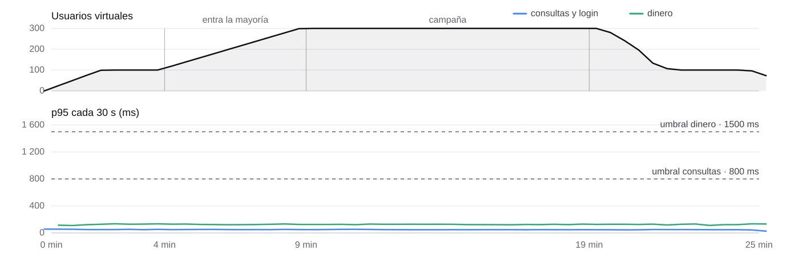

# Rendimiento · Quincena Qolqe

El requerimiento de la Parte 3 pregunta tres cosas: si Qolqe cumple en la hora punta (3000 sesiones por hora), si aguanta la campaña del 15 y fin de mes (el triple de usuarios en 15 minutos) y hasta cuántos usuarios simultáneos puede crecer. Y pone una condición que no es de tiempo: ninguna operación de dinero puede quedar a medias ni aplicarse dos veces.

**Respuesta corta:** la hora punta y la campaña cumplen con mucho margen. El límite está entre 600 y 800 usuarios y, al pasarlo, Qolqe no se pone lento: se traba (DEF-10). El riesgo más serio no es de carga: dos transferencias simultáneas de la misma cuenta se saltan el límite diario y el saldo (DEF-11).

El informe completo, con el modelo de carga, los supuestos y todas las tablas, está en [`Informe_Rendimiento_G5.docx`](Informe_Rendimiento_G5.docx) ([PDF](Informe_Rendimiento_G5.pdf)). Los scripts y cómo correrlos, en [`tests/performance/`](../tests/performance/README.md).

## Cómo se probó

- **Herramienta:** k6 v2.3. Los umbrales del requerimiento van en el script (`p(95)<800` para consultas, `p(95)<1500` para dinero, `rate<0.01` para fallas) y k6 dice si pasó.
- **Entorno:** Qolqe en Docker con 1 CPU y 1 GB (uvicorn con un proceso, SQLite en WAL); k6 nativo en la misma laptop (MacBook Pro M5, 16 GB). Es una línea base relativa, no la capacidad de producción.
- **Sesión:** cada VU inicia sesión y hace 6 operaciones sorteadas con los porcentajes del requerimiento, con una pausa de 10 a 25 s (triangular, promedio exacto de 18 s).
- **Usuarios:** hora punta = 3000 sesiones/h × 2 min = **100 VUs** (ley de Little); campaña = **300 VUs**, con la subida en los primeros 5 minutos.
- **Datos:** un usuario distinto por VU, con saldo, deudas y contactos propios, para que ninguna regla de negocio falle por compartir datos.
- **Dinero:** antes y después de cada prueba se compara la base: saldos contra movimientos, cada transferencia con su salida y su entrada, ninguna deuda pagada dos veces y las operaciones guardadas contra las respuestas 201 que vio k6.
- **Recursos:** CPU, memoria e hilos de Qolqe y de k6, cada segundo.

## Resultados

| Prueba | VUs | p95 consultas | p95 dinero | Errores | Throughput | Dinero | Veredicto |
|---|---|---|---|---|---|---|---|
| Carga (hora punta, 20 min) | 100 | 51 ms | 126 ms | 0 % | 55 sesiones/min | cuadra | Cumple |
| Pico (campaña) | 100 → 300 → 100 | 48 ms | 127 ms | 0 % | 166 sesiones/min | cuadra | Cumple, sin degradación |
| Resistencia (60 min) | 100 | 42 ms | 126 ms | 0 % | 56 sesiones/min | cuadra | Cumple |
| Estrés (escalones) | 600 | 51 ms | 126 ms | 0 % | 315 sesiones/min | — | Cumple |
| Estrés (escalones) | 800 | 60 s | 60 s | 86 % | 45 sesiones/min | 6 operaciones sin confirmar | Se traba (DEF-10) |
| Concurrencia (misma cuenta) | 1 | — | — | — | — | límite y saldo superados en 5 de 5 rondas | Falla (DEF-11) |

Umbrales: consultas y login p95 < 800 ms, dinero p95 < 1500 ms, fallas < 1 %, al menos 50 sesiones por minuto con 100 VUs. Para la campaña se tomó como supuesto que «degradación razonable» es hasta el doble de esos tiempos; no hizo falta.

## Hora punta y campaña: cumplen lejos del umbral

Con 100 usuarios, el p95 de consultas fue 51 ms y el de dinero 126 ms (casi todo es la pausa de 40 a 120 ms del antifraude de las transferencias). Las cuatro ventanas de 5 minutos dan lo mismo, así que no se acumulan retrasos. Qolqe usó el 8 % de su CPU.

En la campaña, de 100 a 300 usuarios en 5 minutos y 10 minutos arriba, los tiempos no se movieron (48 ms y 127 ms) y al volver a 100 quedaron igual que antes.

## Estrés: con 600 cumple, con 800 se traba

El estrés subió en escalones de 100, 300, 600, 800, 1000, 1200 y 1400 usuarios. Hasta 600 todo está en verde. Al subir a 800, en menos de un minuto el p95 pasa de 50 ms al timeout de 60 s, el 86 % de las peticiones falla y el throughput cae de 40 a 10 peticiones por segundo. No se recupera en los 16 minutos siguientes. Antes, un sondeo con una subida más suave había aguantado hasta 1000: el quiebre depende de cuántos usuarios entran juntos, no solo de cuántos hay.

**Capacidad estimada: 600 usuarios simultáneos**, seis veces la hora punta y el doble de la campaña.

## El cuello de botella: un candado y 40 hilos

No es el CPU: al trabarse, el CPU de Qolqe baja de 35 % a 15 %. Tampoco la memoria: sube después, de 75 a 780 MB, porque se acumulan las peticiones en cola.

1. Una escritura (el login guarda la sesión; transferir, recargar y pagar mueven saldo) toma el candado de escritura de SQLite.
2. Las demás escrituras esperan ese candado hasta 10 s (`busy_timeout`), cada una ocupando uno de los 40 hilos del pool de FastAPI.
3. El que tiene el candado todavía no hizo `commit`: `obtener_bd` lo hace al salir, y antes de eso FastAPI valida la respuesta en ese mismo pool de hilos.
4. Cuando los 40 hilos están esperando el candado, su dueño no consigue hilo para terminar. Todo se queda quieto hasta que vence el timeout, y vuelve a pasar con la siguiente ola.

Evidencia: los hilos de Qolqe saltan de 17 a 51 (8 de base más los 40 del pool) en el mismo minuto en que el p95 se dispara; los 500 llegan a los 10.4–10.9 s, justo el `busy_timeout`; el log del estrés tiene 3878 `sqlite3.OperationalError: database is locked`, el 81 % en el `INSERT` de la sesión del login. Detalle y pasos en [DEF-10](defectos.md#def-10-desde-unos-800-usuarios-simultáneos-el-servicio-se-traba-y-responde-500-database-is-locked).

## El dinero

En carga, pico y resistencia el dinero cuadra siempre: 2106, 4937 y 5984 operaciones de dinero sin ninguna a medias ni duplicada. Durante el colapso del estrés, 6 operaciones (3 en el sondeo) quedaron guardadas aunque el cliente recibió error o timeout: el usuario ve «error», reintenta y paga dos veces.

Con un usuario por VU, dos operaciones de la misma cuenta nunca coinciden, así que se agregó [`concurrencia.js`](../tests/performance/escenarios/concurrencia.js), que manda las mismas operaciones a la vez (un doble clic o un reintento de la app):

| Caso | Esperado | Obtenido (5 de 5 rondas) |
|---|---|---|
| Diego: 5 transferencias de S/ 300 a la vez, límite S/ 1000 | 3 aceptadas, S/ 900 | **5 aceptadas, S/ 1500** |
| Carla: 2 transferencias de S/ 40 a la vez, saldo S/ 50 | 1 aceptada, saldo S/ 10 | **2 aceptadas, saldo S/ −30** |
| La misma deuda pagada 2 veces a la vez | 1 cobro | 1 cobro |

Las transferencias leen el saldo y lo usado hoy antes de consultar al antifraude (que tarda 40 a 120 ms) y fuera de una transacción, así que todas leen lo mismo y todas pasan. Es [DEF-11](defectos.md#def-11-transferencias-simultáneas-de-la-misma-cuenta-se-saltan-el-límite-diario-y-el-saldo), crítico, y ahora lo detectan también los escenarios CP-53 y CP-86 de la suite de API.

## Resistencia: una hora sin acumular nada

Qolqe opera de 6:00 a 24:00 sin reinicios. Se corrió la hora punta durante 60 minutos: en las 12 ventanas de 5 minutos el p95 de consultas quedó entre 39 y 45 ms y el de dinero entre 122 y 129 ms, sin errores. La memoria pasó de 61 a 69 MB (+5.5 MB por hora: unos +99 MB en 18 horas, lejos del 1 GB). La base crece 3.2 MB por hora y la tabla de sesiones suma unas 3300 filas por hora sin que nada la limpie.

Hubo dos pausas breves, en los minutos 23 y 49: 15 de 25 034 peticiones tardaron más de 300 ms (la peor, 1045 ms), todas con éxito. Afectaron a todas las operaciones a la vez, como una tarea interna que corre cada cierto tiempo; sospechamos del checkpoint del WAL de SQLite, pero no lo confirmamos.

## Qué recomendamos

1. Validar saldo y límite dentro de la transacción de escritura (DEF-11).
2. Una clave de idempotencia en transferir, recargar y pagar, para que un reintento no cobre dos veces.
3. Hacer el `commit` dentro del endpoint, para que el candado no dependa de conseguir un hilo (DEF-10).
4. Bajar el `busy_timeout` y limitar la concurrencia de uvicorn: responder 503 rápido en vez de colgar 60 s.
5. Para crecer más allá de 600 usuarios: PostgreSQL y varios procesos; con SQLite hay un solo escritor.
6. Una alarma cuando el pool de hilos pase el 50 % y repetir el estrés después de cada cambio.

## Archivos

| Qué | Dónde |
|---|---|
| Sesión, umbrales y escenarios | [`tests/performance/`](../tests/performance/README.md) |
| Resultados de cada prueba (reporte HTML de k6, CSV de recursos, gráficos, resumen) | [`tests/performance/resultados/`](../tests/performance/resultados/) |
| Informe con la plantilla del curso | [`Informe_Rendimiento_G5.docx`](Informe_Rendimiento_G5.docx) · [PDF](Informe_Rendimiento_G5.pdf) |
| Defectos | [`defectos.md`](defectos.md): DEF-10 y DEF-11 |
| Diapositivas | [`expo/parte3.html`](expo/parte3.html) · [PDF](expo/G5-Limites-Parte3.pdf) |
